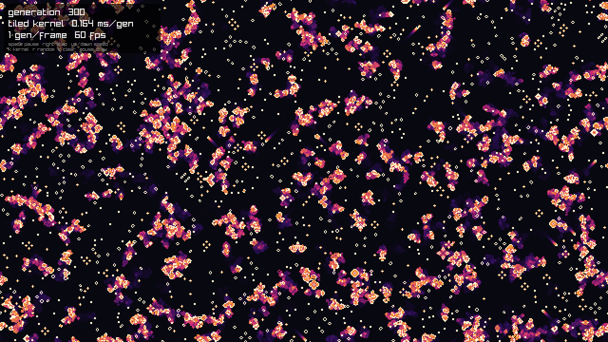

# Conway's Game of Life in CUDA



Game of Life written a few different ways, starting from a plain CPU loop and ending with a
bit-packed GPU kernel that's about 13,000x faster than the CPU and 36x faster than my first GPU version.
Every version is checked against the CPU one, and they all end with the exact same board.

Machine: RTX 4070 Laptop GPU (Ada, sm_89, 8 GB GDDR6, ~256 GB/s), CUDA 12.0, WSL2 on Windows.

## Results

4096 x 4096 board, random start, wrap-around edges. Times are measured on the GPU with `cudaEvent`s
(CPU uses `std::chrono`).

| Version | ms per generation | cells / s | vs CPU | vs naive GPU |
|---|---|---|---|---|
| CPU (`cpu_life_bench.cu`) | 266.7 | 6.3e7 | 1x | |
| Naive GPU (`gpu_life_bench.cu`) | 0.72 | 2.3e10 | ~370x | 1x |
| Shared memory tiles (`gpu_life_tiled.cu`) | 0.73 | 2.3e10 | ~365x | ~1x |
| Bit-packed (`gpu_life_bits.cu`) | 0.020 | 8.4e11 | ~13,000x | ~36x |

On a 16384 x 16384 board the bit-packed version runs at 0.29 to 0.31 ms per generation (~8.7e11 cells/s),
41x faster than naive.

## The versions

**`cpu_life.cu` / `gpu_life.cu`**: the first versions, a 16 x 16 board with a glider printed every
generation. Used to check the rules and the edge wrapping by eye.

**`cpu_life_bench.cu`**: the reference. Counts the 8 neighbors of every cell with `%` to wrap around
the edges, reads from one grid and writes to another, then swaps them.

**`gpu_life_bench.cu`**: the same code with the two outer loops replaced by a 2D grid of threads,
one thread per cell. The board stays on the GPU the whole time and the two device buffers get
swapped (ping-pong) every generation. Every CUDA call goes through a `CHECK()` macro.

**`gpu_life_tiled.cu`**: each 16 x 16 block copies its tile plus a 1 cell border (the halo) into
shared memory, `__syncthreads()`, then counts neighbors from shared memory instead of global memory.
The bounds check has to come after the barrier, otherwise threads that return early leave the
rest of the block waiting.

**`gpu_life_bits.cu`**: 1 bit per cell, 32 cells per `uint32`, one thread per word. Instead of
visiting neighbors one at a time, a whole row is shifted left and right by 1 bit, so one shift gives
the left (or right) neighbor of all 32 cells at once. The 8 neighbor masks are added together with
a 3 bit counter built out of AND/XOR (32 tiny adders running side by side in one register), and the
rules become `c1 & ~c2 & (c0 | alive)`.

**`life_viz.cu`**: raylib window running the naive or tiled kernel live. A second kernel turns the
board into pixels on the GPU and leaves a fading trail behind cells that died, so only the finished
image gets copied back each frame.

## What I found

### Tiling didn't help

The shared memory version came out within a few percent of the naive one (sometimes slightly
faster, sometimes slightly slower between runs). The idea behind tiling is that each cell gets read
9 times (by itself and its 8 neighbors), so loading it once into shared memory should save 8 reads.
But Ada has a big L1 and a 32 MB L2, and neighboring threads read the same rows at almost the same
time, so the cache was already catching most of those repeat reads. Tiling saved reads that weren't
really going to DRAM anyway, and paid for it with the extra halo loads and a `__syncthreads()`.

### What actually mattered

I swept block shapes, data types and the wrap-around math (4096 x 4096, 1000 generations, all
results checked cell by cell against the naive kernel):

| Change | ms per gen | vs naive |
|---|---|---|
| naive, `int`, 16 x 16 blocks | 0.694 | 1.00x |
| block shape 32x8 / 32x16 / 64x4 / 128x2 / 256x1 | 0.67 to 0.74 | 0.94x to 1.04x |
| block shape 32 x 32 | 0.828 | 0.84x |
| `unsigned char` instead of `int` | 0.484 | 1.43x |
| `int`, wrap with `if` instead of `%` | 0.558 | 1.25x |
| `unsigned char` + `if` instead of `%` | 0.280 | 2.48x |
| bit-packed, `uint32` | 0.019 to 0.025 | ~32x to 36x |
| bit-packed, each thread walks 4 to 16 rows | 0.016 to 0.023 | ~30x to 42x |

- **Block shape barely matters** as long as the block is at least 32 wide, so a warp reads one
  continuous piece of a row. 32 x 32 was the only shape that was clearly worse.
- **The `%` was costing ~20%.** Integer division is slow on the GPU, and the naive kernel does 16 of
  them per cell. Swapping them for `if`s brought the `int` version to roughly 240 GB/s of effective
  bandwidth (each grid read once and written once per generation), which is about all this card has.
  So the naive kernel was partly held back by math, not only by memory.
- **Smaller cells only help once the math is gone.** `int` to `unsigned char` is 4x less data but only
  1.4x faster on its own. With `%` removed as well it's 2.5x. At 16384 x 16384 the byte version only
  reaches ~110 GB/s, so it's limited by the number of load instructions (9 single-byte loads per cell)
  rather than bandwidth.
- **Bit packing fixes both problems at once**: 32x less data, and one load brings in 32 cells. At
  16384 x 16384 it reaches roughly 210 to 220 GB/s effective, back near the memory limit, but now each
  byte carries 8 cells instead of a quarter of one.
- **Walking several rows per thread** (reusing the rows already loaded) helped a little at 4096 x 4096
  but was ~25% slower at 16384 x 16384, so the simple one-word-per-thread kernel is the one in the repo.

### Nsight Systems

Profiled with `make nsys` (CUDA API trace + NVTX ranges, 4096 x 4096, 1000 generations).

| | naive | tiled | bits |
|---|---|---|---|
| NVTX "simulate" range | 769 ms | 744 ms | 25.7 ms |
| `cudaLaunchKernel` median | 5.2 us | 5.8 us | 5.3 us |
| slowest `cudaLaunchKernel` | 7.7 ms | 8.0 ms | 8.1 ms |
| first `cudaMalloc` | 317 ms | 274 ms | 298 ms |

- **The first `cudaMalloc` takes ~300 ms** because it's the call that creates the CUDA context. It's
  outside the timed region, but it's most of the program's total run time.
- **The first kernel launch takes ~8 ms** while CUDA loads the kernel code (CUDA 12 loads modules
  lazily). This is why every benchmark does a warm-up launch before starting the timer.
- **Launch overhead now matters for the bit-packed kernel.** Each launch costs the CPU about 5 us,
  and the kernel itself runs for about 20 us at 4096 x 4096. For naive (720 us per kernel) the launch
  cost is invisible, but for bits it's a quarter of the kernel time, and on a smaller board the CPU
  wouldn't be able to launch kernels as fast as the GPU finishes them. A CUDA Graph, or running
  several generations per launch, would be the next step.

GPU-side kernel timings aren't in these reports yet. On WSL, Nsight needs GPU performance counter
access turned on in the Windows NVIDIA Control Panel (see below).

## Building and running

Needs nvcc, and raylib for the visualizer (static lib in `/usr/local/lib`).

```bash
make            # build everything
make check      # all four versions on a 1024 x 768 board, the live cell counts should match
make bench      # the numbers above
./life_viz      # visualizer
```

Every benchmark takes `[width] [height] [generations]`, for example `./gpu_life_bits 16384 16384 1000`.
The bit-packed version needs the width to be a multiple of 32.

Visualizer controls: space pause, right arrow single step, up/down generations per frame,
`k` switch between naive and tiled kernel, `r` random board, `c` clear, left mouse draw, right mouse erase.
`./life_viz --screenshot` saves `screenshot.png` and quits.

### Profiling on WSL

Ubuntu's packaged `nsys`/`ncu` (2022.4) are too old for driver 561. The Makefile points at the
CUDA 12.6 versions (Nsight Systems 2024.5.1, Nsight Compute 2024.3.2) unpacked from NVIDIA's apt
repo into `~/.local/nsight`. Kernel timings and Nsight Compute also need
**NVIDIA Control Panel > Desktop > Enable Developer Settings**, then
**Developer > Manage GPU Performance Counters > Allow access to the GPU performance counters to all users**
on the Windows side.

```bash
make nsys   # timelines in profiles/*.nsys-rep, open them in the Nsight Systems GUI
make ncu    # per-kernel reports in profiles/*.ncu-rep
```
